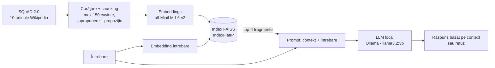

# Sistem RAG local: FAISS + sentence-transformers + Ollama

Proiect de laborator: un sistem **RAG (Retrieval-Augmented Generation)** care rulează complet local, pe CPU, fără API-uri plătite și fără chei API. Sistemul răspunde la întrebări pe baza unor articole Wikipedia din datasetul **SQuAD 2.0**. Fragmentele relevante sunt găsite cu un index vectorial **FAISS**, iar răspunsul este generat de un model LLM local rulat prin **Ollama** (`llama3.2:3b`).

Tot proiectul se află într-un singur notebook Jupyter: [`Laborator_RAG_SQuAD_Ollama.ipynb`](Laborator_RAG_SQuAD_Ollama.ipynb).

**Autor:** Iatco Marcel

---

## Cum funcționează



1. **Date:** se descarcă setul *dev* SQuAD 2.0 și se păstrează 10 articole.
2. **Preprocesare și chunking:** normalizare Unicode și a spațiilor. Paragrafele lungi sunt împărțite la granița propozițiilor, cu o propoziție de suprapunere între fragmente.
3. **Embeddings și index:** vectori de 384 de dimensiuni, normalizați, deci produsul scalar din FAISS este similaritatea cosinus. Căutarea este exactă.
4. **Generare:** cele mai relevante 4 fragmente sunt puse în prompt. Modelul primește instrucțiunea să răspundă **doar** din context și să spună `I don't know based on the provided context.` dacă informația lipsește. Temperatura este 0.
5. **Evaluare:** se măsoară separat calitatea căutării (Hit@k, MRR) și calitatea răspunsurilor (cu RAG vs. fără RAG).

---

## Dataset

| | |
|---|---|
| **Sursă** | [SQuAD 2.0](https://rajpurkar.github.io/SQuAD-explorer/) (Rajpurkar et al., 2018), setul *dev*, descărcat din [repository-ul autorilor](https://github.com/rajpurkar/SQuAD-explorer) |
| **Licență** | CC BY-SA 4.0 |
| **Subset folosit** | 10 articole: Normans, Steam_engine, Oxygen, Amazon_rainforest, Black_Death, Immune_system, Prime_number, Rhine, Warsaw, Force |
| **Dimensiune** | 389 de paragrafe → **465 de fragmente**; 3.697 de întrebări, dintre care 1.752 fără răspuns |

SQuAD este potrivit pentru RAG din două motive:
- fiecare întrebare are **răspunsul corect și paragraful-sursă cunoscute**, deci căutarea se poate evalua obiectiv;
- SQuAD 2.0 conține întrebări marcate explicit ca **fără răspuns**, utile pentru a testa dacă sistemul refuză corect.

Datasetul (~4,4 MB) se descarcă automat la prima rulare în folderul `data/`, deci nu trebuie inclus în repository.

---

## Tehnologii

| Componentă | Tehnologie |
|---|---|
| Embeddings | `sentence-transformers`, modelul `all-MiniLM-L6-v2` |
| Index vectorial | `faiss-cpu` (`IndexFlatIP`) |
| LLM | Ollama, modelul `llama3.2:3b` (local, pe CPU) |
| Prelucrare date | `pandas`, `numpy` |
| Comunicare HTTP | `requests` (descărcarea datelor și API-ul local Ollama) |
| Mediu | Windows 11, Jupyter în PyCharm, mediu conda, fără GPU dedicat |

---

## Rulare

### 1. Mediul Python
```bash
conda create -n rag-lab python=3.12 -y
conda activate rag-lab
```
Prima celulă a notebook-ului instalează dependențele în kernel-ul curent:
```python
%pip install -q sentence-transformers faiss-cpu pandas numpy requests
```

### 2. Ollama
1. Instalați [Ollama](https://ollama.com) și porniți-o: deschideți aplicația **sau** rulați `ollama serve` într-un terminal separat.
2. Descărcați modelul o singură dată:
   ```bash
   ollama pull llama3.2:3b
   ```

Notebook-ul **nu pornește Ollama automat**. Celula 4.1 verifică o singură dată dacă serviciul răspunde și dacă modelul este descărcat. Dacă ceva lipsește, afișează instrucțiunile necesare. După pornirea manuală a Ollama se rulează din nou doar acea celulă.

### 3. Notebook-ul
Deschideți `Laborator_RAG_SQuAD_Ollama.ipynb` și rulați celulele **de sus în jos**. La prima rulare se descarcă automat datasetul și modelul de embeddings (~90 MB, de pe Hugging Face).

---

## Rezultate

Rezultatele de mai jos provin din rularea notebook-ului pe un laptop cu Windows 11, Intel Core Ultra i7, 32 GB RAM, **fără GPU dedicat**.

### Evaluarea căutării (300 de întrebări cu răspuns, eșantion aleator, `random_state=42`)

Un rezultat este considerat corect dacă fragmentul recuperat provine din paragraful-sursă al întrebării **și** conține răspunsul corect.

| Hit@1 | Hit@3 | Hit@5 | Hit@10 | MRR@10 |
|:---:|:---:|:---:|:---:|:---:|
| 0.673 | 0.857 | **0.917** | 0.960 | 0.780 |

Cu `k = 4` fragmente în prompt, fragmentul corect ajunge în context în aproximativ 86–92% dintre cazuri (între Hit@3 și Hit@5).

### Întrebări de test: RAG vs. fără RAG (același model, `temperature = 0`)

| # | Întrebare | Răspuns corect | Cu RAG | Fără RAG |
|---|---|---|---|---|
| 1 | Who was the first European to travel the Amazon River? | Francisco de Orellana | ✅ Francisco de Orellana (1542) | ⚪ „I don't know” |
| 2 | Which building in Warsaw was a gift from the Soviet Union? | Palace of Culture and Science | ✅ corect | ✅ corect |
| 3 | As of January 2016, how many digits does the largest known prime consist of? | 22,338,618 | ✅ 22,338,618 | ❌ 24,862,048 |
| 4 | What type of steam engine produces most electricity in the world today? | turbine | ✅ steam turbines | ⚠️ „I don't know”, apoi totuși „turbine” |
| 5 | Where is the highest point of the Rhine basin? | Finsteraarhorn | ✅ Finsteraarhorn (4.274 m) | ❌ Feldberg (Taunus), 881 m |
| 6 | What was Warsaw's first literary cabaret? | Momus | ✅ Momus | ⚪ „I don't know” |
| 7 | In what year was Kaffa founded? *(capcană SQuAD 2.0)* | — (nu este în text) | ✅ refuz | ✅ „I don't know” |
| 8 | Who won the 2022 FIFA World Cup? *(în afara domeniului)* | — (nu este în baza de cunoștințe) | ✅ refuz | ℹ️ Argentina (răspuns din cunoștințele modelului) |

✅ corect · ❌ greșit (halucinație) · ⚪ refuz · ⚠️ răspuns contradictoriu · ℹ️ corect în realitate, dar nu provine din baza de cunoștințe

**Rezumat automat din notebook** (verificare aproximativă prin potrivirea textului, confirmată manual în tabelul de mai sus):

| | Cu RAG | Fără RAG |
|---|:---:|:---:|
| Întrebări cu răspuns: conțin răspunsul corect | **6/6** | 2/6 |
| Întrebări fără răspuns în bază: refuz | **2/2** | 1/2 |
| Timp mediu de generare | 12,2 s | 3,8 s |

### Scorul de similaritate al primului fragment (`top1_score`)

| Tip întrebare | `top1_score` |
|---|---|
| Cu răspuns (6 întrebări) | 0,527 – 0,714 |
| Fără răspuns în bază (2 întrebări) | 0,238 și 0,214 |

---

## Observații

- **Căutarea funcționează bine pentru un model mic de embeddings:** Hit@5 = 0,917 și MRR = 0,78. Majoritatea ratărilor apar la întrebări care nu se înțeleg fără paragraful lor, de exemplu „Who was Robert's son?” sau „Where does the Rhine begin?”. Întrebările SQuAD au fost scrise de oameni care vedeau paragraful.
- **RAG elimină halucinațiile observate în test.** Fără context, modelul a inventat un răspuns greșit la întrebarea despre Rin (Feldberg, 881 m) și a dat o cifră greșită pentru 2016 la întrebarea despre numerele prime. 24.862.048 este numărul de cifre al unui număr prim descoperit ulterior, deci modelul a amestecat perioadele. Cu RAG, ambele răspunsuri au fost corecte și se pot verifica în fragmentele recuperate.
- **Fără RAG, modelul refuză des** („I don't know” la întrebările 1 și 6), iar o dată refuză și răspunde în același timp (întrebarea 4). Verificarea automată a considerat întrebarea 4 corectă fără RAG, deși răspunsul este contradictoriu. De aceea tabelul a fost verificat și manual.
- **Refuzul funcționează în ambele cazuri de test.** La întrebarea-capcană despre Kaffa, contextul conține „Kaffa” și anul 1347, dar sistemul RAG nu a confundat acest an cu anul fondării. La întrebarea din afara domeniului, modelul fără RAG a dat răspunsul real (Argentina). Asta nu este o greșeală a modelului, dar arată că răspunsul nu provine din baza de cunoștințe. Sistemul RAG a refuzat, cum era de așteptat.
- **Scorul de similaritate separă clar cazurile pe acest eșantion:** sub 0,24 pentru întrebările fără răspuns și peste 0,52 pentru cele cu răspuns. Un prag de similaritate ar putea filtra contextul irelevant înainte de LLM. Concluzia se bazează însă pe doar 8 întrebări și ar trebui validată pe un eșantion mai mare.
- **Costul RAG este timpul:** în medie 12,2 s față de 3,8 s pe CPU, din cauza promptului mai lung (4 fragmente). Indexarea celor 465 de fragmente a durat 10,3 s.

## Limite

- `all-MiniLM-L6-v2` este antrenat pentru engleză, deci întrebările în română ar fi găsite mult mai slab. Pentru română se poate folosi `paraphrase-multilingual-MiniLM-L12-v2`.
- Retriever-ul întoarce mereu `k` fragmente, chiar și când nu sunt relevante. Refuzul depinde de faptul că LLM-ul respectă instrucțiunea din prompt.
- Evaluarea generării pe 8 întrebări este **ilustrativă, nu statistic semnificativă**. Metrica automată `contains_gold` este aproximativă.
- Baza de cunoștințe este mică (10 articole) și statică.

## Extinderi posibile

- Prag de similaritate pentru refuz înainte de apelul LLM.
- Căutare hibridă (BM25 + vectori) și reranking cu un cross-encoder.
- Evaluarea generării pe mai multe întrebări, cu metrici precum Exact Match / F1.
- Model de embeddings multilingv pentru întrebări în română.

---

## Structura repository-ului

```
├── Laborator_RAG_SQuAD_Ollama.ipynb   # tot codul, explicațiile și rezultatele
├── README.md
└── data/                              # creat automat la rulare (recomandat în .gitignore)
```

## Atribuire

Datele provin din **SQuAD 2.0**: Rajpurkar, P., Jia, R., Liang, P. (2018). *Know What You Don't Know: Unanswerable Questions for SQuAD*. ACL 2018. Datele sunt licențiate CC BY-SA 4.0. Textele provin din Wikipedia.
